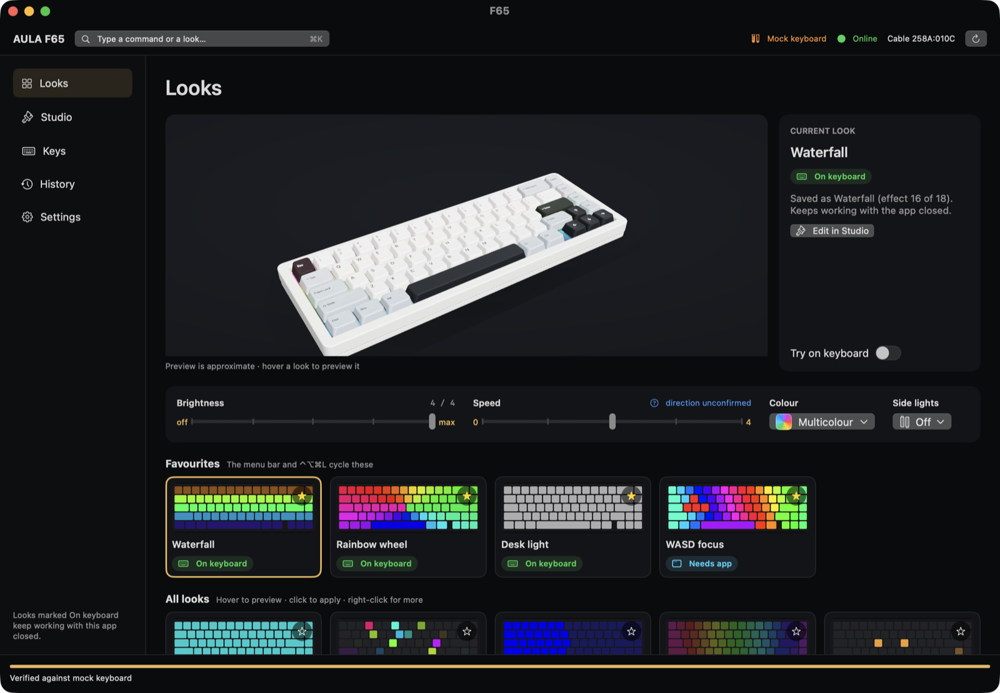
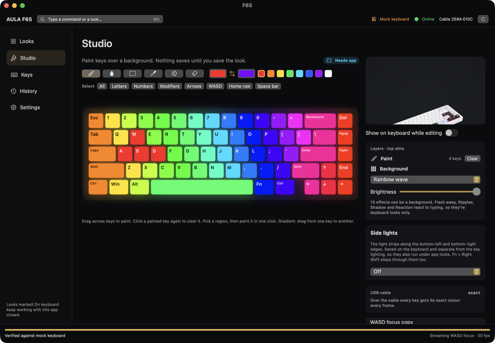
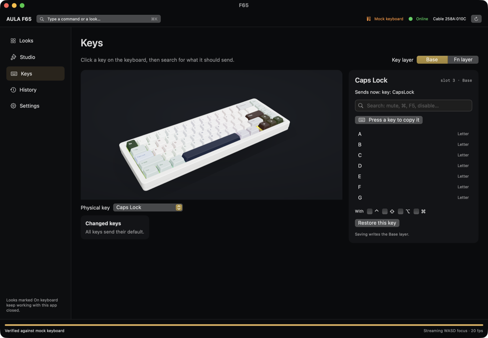
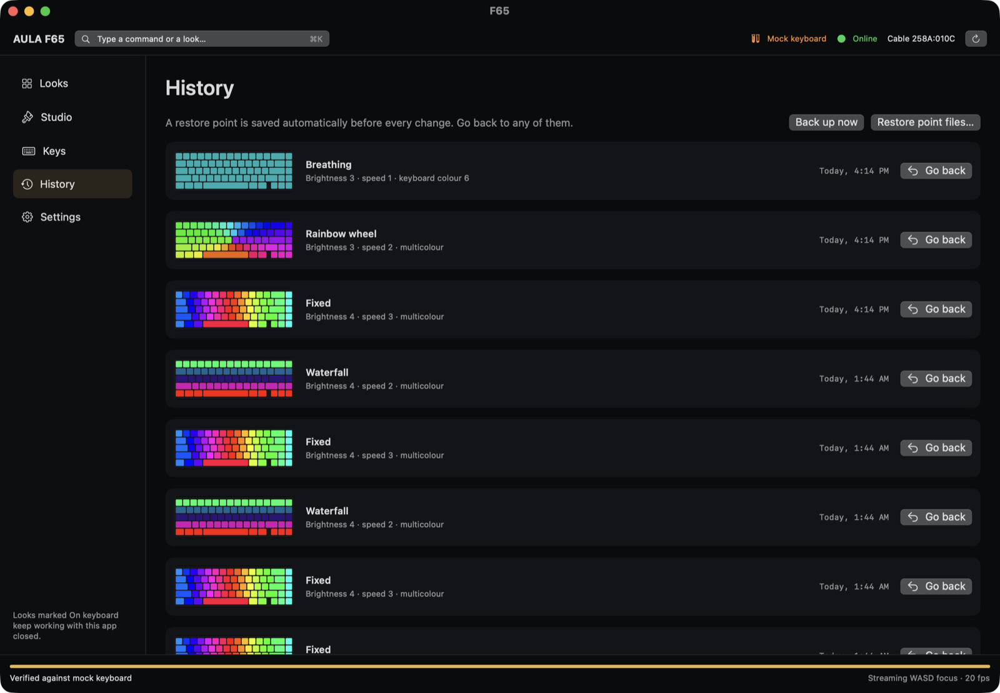
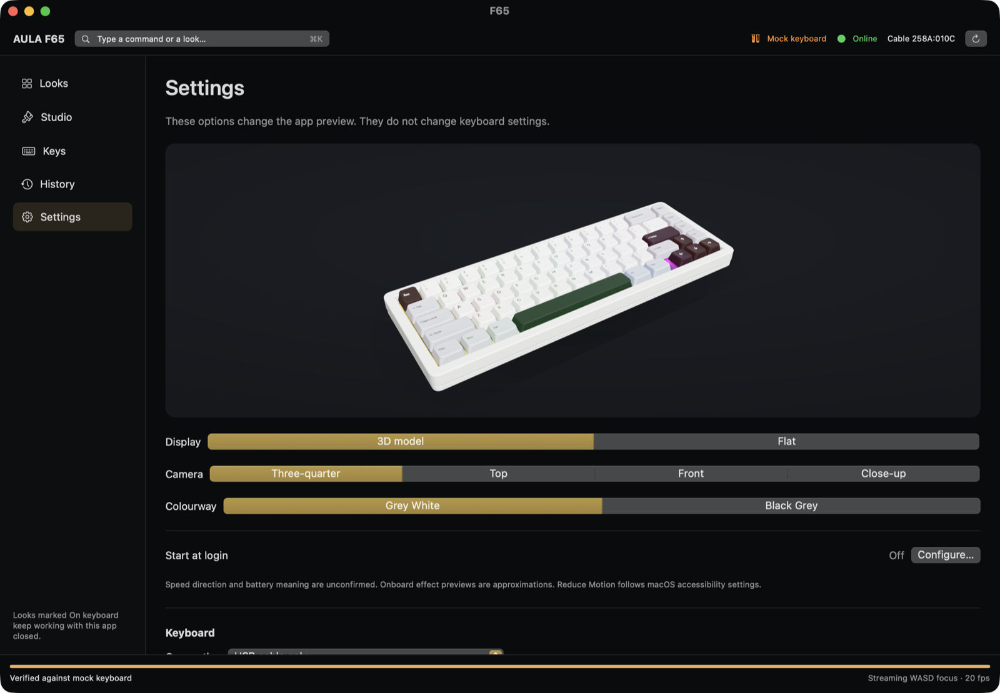
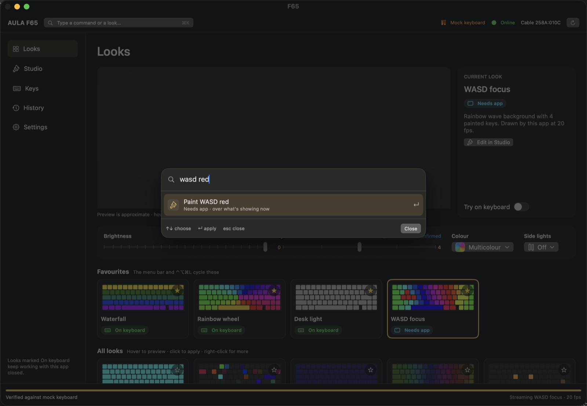

# F65 Lighting for macOS

A native Mac app for the **AULA F65** keyboard. Change its lighting, paint your own key colours, remap keys and go back to any earlier setup, all without the Windows driver.



<sub>All screenshots were taken with the app's built-in mock keyboard, so the toolbar says "Mock keyboard".</sub>

- **Looks:** pick how the keyboard should look from a gallery and click to apply it. Undo with ⌘Z.
- **Studio:** paint individual keys over a moving background (WASD red over a rainbow, for example).
- **Keys:** remap any key on the base layer or the Fn layer. Search for what it should send, or press a key to copy it.
- **History:** a restore point is saved before every change. Go back to any of them with one click.
- **Fast paths:** a ⌘K command bar ("wasd red", "dim 50"), a menu-bar menu, and a global shortcut that cycles your favourites.
- **Safe by design:** every save is backup → write → read back and verify → roll back if anything differs. The app never sends firmware, factory-reset, macro or game-mode writes.

Works over the **USB cable** and the **2.4G wireless receiver**. Bluetooth isn't supported.

---

## Contents

- [Install](#install)
- [First launch](#first-launch)
- [How it works](#how-it-works)
- [A tour of the app](#a-tour-of-the-app)
- [Examples](#examples)
- [Command bar reference](#command-bar-reference)
- [Menu bar and shortcuts](#menu-bar-and-shortcuts)
- [Command-line tools](#command-line-tools)
- [What isn't confirmed yet](#what-isnt-confirmed-yet)
- [Troubleshooting](#troubleshooting)
- [For developers](#for-developers)

---

## Install

There's no download yet, so you build the app from source. It takes about a minute.

**You need**
- macOS 13 Ventura or later
- Xcode 15.3 or later (free from the App Store). Open it once after installing so it can finish setting up.
- An AULA F65, connected with the USB cable or the 2.4G receiver

**Build it**

```bash
git clone https://github.com/sainag7/aula-f65-mac.git
```

```bash
cd aula-f65-mac/app && ./build.sh
```

```bash
open "F65 Lighting.app"
```

`build.sh` compiles a release build and puts `F65 Lighting.app` in the `app` folder. If it finds an Apple Development certificate on your Mac it signs the app with it, so macOS remembers the app's permissions between rebuilds. Otherwise it uses an ad-hoc signature.

**Optional:** copy it to Applications so you can launch it from Spotlight.

```bash
cp -R "F65 Lighting.app" /Applications/
```

**Updating:** run `git pull`, then `./build.sh` again. Quit the running app (menu-bar icon → **Quit F65 Lighting**) and reopen it so the new build loads.

## First launch

1. **Allow Input Monitoring.** The keyboard's lighting controls sit on the same USB device as its keys, so macOS asks whether "F65 Lighting" may *receive keystrokes from any application*. The app never reads what you type, but macOS asks this for any app that talks to a keyboard. Click **Open System Settings**, turn on **F65 Lighting** under Privacy & Security → Input Monitoring, then quit and reopen the app.
2. **Connect the keyboard.** The toolbar shows **Online** and either `Cable 258A:010C` or `2.4G 3554:FA09`. On wireless the keyboard falls asleep when idle. If you see *"Press any key on the F65 to wake it"*, press any key.
3. **Pick a look.** Click one of the cards on the Looks screen. That's it.

The app lives in the **menu bar** (keyboard icon). The Dock icon only appears while the main window is open. Closing the window keeps the app running in the menu bar.

---

## How it works

### Two kinds of looks

Everything the keyboard can show is a **Look**, and every look carries one of two badges:

| Badge | What it is | Works with the app closed? |
|---|---|---|
| 🟩 **On keyboard** | One of the F65's 18 built-in effects (Waterfall, Rainbow wheel, Breathing…) with its own brightness, speed and colour. Saved into the keyboard's memory. | **Yes.** It's stored on the keyboard. |
| 🟦 **Needs app** | Anything with painted keys or colours the keyboard can't store: a background plus per-key colours. The app draws it and sends a new picture 20 times a second. Nothing is saved on the keyboard. | **No.** About a second after the app stops, the keyboard goes back to its saved effect. |

The F65 can't store per-key colours in its own memory. Painted looks always need the app running.

### Cable vs. wireless (and the "Fixed" popup)

| | USB cable | 2.4G receiver |
|---|---|---|
| Saving settings | One report per block. All-or-nothing, fastest. | 10–36 small packets, each acknowledged. Slower. |
| Needs-app looks | Every key gets its exact colour every frame. | Up to 168 bytes per frame. Painted keys stay exact, and a busy background is simplified to fit. |
| Catch | none | The keyboard **only shows app-drawn lighting while its saved effect is Fixed.** |

That catch is why you'll see this popup when you apply a Needs-app look over wireless:

> **WASD focus is drawn by this app.** Over 2.4G the F65 only shows app-drawn lighting while its saved effect is Fixed. Set the saved effect to Fixed now?

- **Set to Fixed and apply:** one lighting save (with a restore point first), then your look shows. When you quit the app, the keyboard shows the plain Fixed colour instead of the effect it had before. Applying any On-keyboard look switches that back.
- **Apply without it:** nothing changes on the keyboard, and the look only appears in the app's preview.
- **Always set Fixed for app looks:** don't ask again.

Over the cable none of this is needed.

### The 7 keyboard colours

On-keyboard effects can only use the keyboard's **7-colour palette**, which starts as red, green, blue, yellow, magenta, cyan and white. If you pick a colour that isn't one of the 7, the colour chooser shows three options:
- **replace** the least-used palette colour. It tells you which other saved effects use that colour too.
- use the **nearest** of the 7.
- turn it into a **Needs app** look, which can show any colour.

### Every save is protected

Each change to the keyboard follows the same steps:

1. Check that the keyboard is awake and answering.
2. Save a **restore point**, the keyboard's full settings, to `~/Library/Application Support/F65Lighting/backups/`.
3. Write the change.
4. Read it back and compare every changed byte.
5. If anything differs, retry once, then **roll back** to the restore point and verify the rollback.

The app only ever writes three things: **key layers** (command 01), **lighting** (04) and the **colour palette** (09). Firmware updates, factory reset, macros and game mode are never written.

Lighting changes from the sliders are batched. The app waits 0.4 s after you stop dragging and then saves once. Each lighting save briefly blinks the keyboard's lights; that's the keyboard storing its settings, not an error.

---

## A tour of the app

The window has five sections in the sidebar. The toolbar shows the connection, a refresh button and the ⌘K command bar, and the status line at the bottom shows what was last saved.

### Looks


- **The big preview** shows the current look. Hover any card to preview it there. The preview is drawn by the app, so it's an approximation of the real lighting.
- **Current look** says what's on the keyboard, whether it's On keyboard or Needs app, and has **Edit in Studio**.
- **Try on keyboard:** turn it on and hovering a card shows that look on the real keyboard before you commit. This works over the cable, or over 2.4G while the saved effect is Fixed.
- **Quick-tune bar:** changes apply to whatever is showing.
  - **Brightness:** the keyboard's 5 steps (off → max) for On-keyboard looks, 0–100 % for Needs-app looks.
  - **Speed:** 0–4. Whether higher means faster isn't confirmed (see below).
  - **Colour:** one of the 7 keyboard colours or multicolour, or any colour for Needs-app looks.
  - **Side lights:** the light strips along the bottom edges. Off, Rainbow flow, Colour cycle, Solid or Breathing, with brightness, speed and colour.
- **Favourites:** click ☆ on any card. Favourites show in the menu bar, and ⌃⌥⌘L cycles them from anywhere.
- **All looks:** right-click a card to favourite it, edit a copy in Studio, or delete it.
- **Onboard effects** at the bottom of the page lists all 18 built-in effects. Click one to switch to it.

The app comes with these starter looks:

| On keyboard | Needs app |
|---|---|
| Waterfall, Rainbow wheel, Calm breathing, Desk light, Starfield, Storm, Ripples | WASD focus (red WASD over a rainbow wave), Night coder (amber F/J and arrows on dark), Sunset (orange-to-blue gradient), Synthwave (cyan Space/Enter/Esc over a pink sine wave) |

After any change a toast appears at the bottom with **Undo**. ⌘Z works too.

### Studio



Paint keys over a background. Nothing is saved until you click **Save look**.

- **Tools** (left to right): **Brush**, **Fill** (fills keys of the same colour that touch), **Select**, **Eyedropper**, **Gradient** (drag from one key to another), **Eraser**.
- **Brush tips:** drag across keys to paint them. **Click a painted key again to clear it.** If you start a drag on a key that already has the brush colour, the whole drag clears instead.
- **Two colour wells.** The ⇆ button swaps them. Quick swatches sit next to them.
- **Select** buttons pick a whole region: All, Letters, Numbers, Modifiers, Arrows, WASD, Home row, Space bar. A bar then offers **Paint**, **Gradient** (first colour → second, left to right) and **Unpaint**. The Select tool does the same for keys you drag a box around.
- **Layers** (top wins):
  - **Paint:** your painted keys. Shows how many are painted and has **Clear**.
  - **Background:** Dark, Solid, Rainbow wave, or one of 13 keyboard effects the app can draw (Waterfall, Neon, Sine wave…). Flash away, Ripples, Shadow and Reaction react to typing, so the app can't draw them. They're available as On-keyboard looks only.
- **Side lights:** the same controls as on the Looks screen.
- **Budget meter:** over 2.4G, a frame fits 168 bytes. Painted keys always stay exact, and the background is simplified when it doesn't fit. Over the cable it says **exact**.
- **Show on keyboard while editing:** streams your draft to the real keyboard as you paint.

### Keys



1. Click a key on the keyboard picture, or choose it from **Physical key**.
2. Pick **Base** or **Fn layer** at the top right.
3. Type in the search field. It understands everyday words: `mute`, `volume`, `⌘` or `cmd`, `escape`, `F5`, `disable`. Or click **Press a key to copy it** and press the key you want.
4. Optionally tick ⌃ ⇧ ⌥ ⌘ to send a combination (for example ⌥ + Tab).
5. Click the result. It saves right away, with a restore point first.

**Changed keys** lists every base-layer key that no longer sends its default, each with a **Reset** button. Keys that control the Fn layer or switch connections are protected: changing them asks you first. The cable is recommended for key changes because the key map is the biggest block (36 packets over wireless).

### History



Every restore point is shown with a thumbnail drawn from the lighting it saved.

- **Go back** writes only the parts that differ from now. If the key layers are different too, it asks first.
- **Back up now** saves a restore point without changing anything.
- **Restore point files…** lets you import, reveal in Finder or fully restore a file.

Needs-app looks aren't stored on the keyboard, so they don't appear here. Use Undo for those.

### Settings



- **Display:** 3D model or Flat preview, with camera angle and colourway (Grey White or Black Grey). These only change the picture in the app.
- **Start at login:** the app starts quietly in the menu bar.
- **Keyboard:**
  - **Connection:** Automatic (prefers the cable), USB cable only, or 2.4G receiver only.
  - **Pause app looks.**
  - **Speed direction check** (see below).
  - **Layout file** for the menu bar's Custom layout mode.
  - **Side lights.**
  - **Macros:** shown read-only.

### ⌘K command bar



Press **⌘K** anywhere in the window and type what you want. ↑/↓ choose a suggestion, Return applies it, Esc closes the bar. The full list is in the [reference](#command-bar-reference) below.

---

## Examples

**Red WASD keys over a rainbow (for games)**
1. ⌘K → type `wasd red` → Return. Or apply the **WASD focus** starter look.
2. Over wireless, choose **Set to Fixed and apply** in the popup.

**Dim the keyboard at night**
- ⌘K → `dim 25`, or drag **Brightness** in the quick-tune bar. `off` turns the key lights off. The setting is saved on the keyboard, so it stays dim with the app closed.

**Make your own look**
1. Studio → choose **Background: Dark**.
2. Pick amber in the first colour well, click **Home row**, then **Paint**. Switch the brush to white and click F and J.
3. Click **Save look** and give it a name. It appears in the gallery. Star it to add it to your favourites.

**Switch between favourites without opening the window**
- Press **⌃⌥⌘L** anywhere, or click the menu-bar icon and pick one under **Favourite looks**.

**Make Caps Lock a Control key**
- Keys → click Caps Lock → search `left control` → click **Left Control**. To undo it, use **Reset** in *Changed keys*.

**Fn + F as play/pause**
- Keys → switch to **Fn layer** → click F → search `play` → **Play/Pause**.

**Go back to how it was this morning**
- History → find the restore point by its time and thumbnail → **Go back**.

**Exact per-key colours from a file**
- Menu bar → **Mode → Custom layout**, then **Edit Layout…**. The file is `~/Library/Application Support/F65Lighting/layout.json`, and changes are picked up within about 2 seconds:

  ```json
  {
    "rest": "#100020",
    "keys": {
      "esc": "#00ffff",
      "w": "#ff0000", "a": "#ff0000", "s": "#ff0000", "d": "#ff0000",
      "space": "#ffffff"
    }
  }
  ```
  `rest` colours every key not listed (`"off"` keeps them dark). Colours can be `#rrggbb`, `#rgb` or a name: `red green blue yellow purple magenta cyan white orange pink off`. [app/README.md](app/README.md#custom-layout-file) lists every key name.

---

## Command bar reference

| Type | What happens |
|---|---|
| `wasd red`, `arrows cyan`, `home row amber`, `esc enter #ff8800` | Paints those keys over what's showing now (a Needs-app look) |
| `red`, `#6a00ff` | Changes the colour of the current look |
| `dim 50`, `brightness 80`, `40%`, `bright` | Sets brightness. On-keyboard looks round to the nearest of the keyboard's 5 steps |
| `off`, `lights off` | Brightness 0 |
| `storm`, `waterfall`, `sunset` | Applies a saved look or an onboard effect by name |
| `undo` | Undoes the last change (same as ⌘Z) |

Regions you can paint: `wasd`, `arrows`, `letters`, `numbers`, `modifiers`, `space`, `home row`, `all`. Keys you can name: `esc`, `enter`, `tab`, `caps`, `backspace`, `delete`, `fn`, `shift`, `ctrl`, `alt`/`option`, single letters and digits. Colour names: `red green blue yellow magenta pink cyan white orange purple amber`, or any `#rrggbb`.

## Menu bar and shortcuts

Click the keyboard icon in the menu bar:

| Item | What it does |
|---|---|
| **Open F65…** (⌘O) | Opens the main window |
| **Command…** (⌘K) | Opens the window with the command bar |
| **Favourite looks** | Your starred looks with small previews. Click one to apply it |
| **Next Favourite** (⌃⌥⌘L, works in any app) | Cycles through your favourites |
| **Live lighting → Mode** | Off, Solid colour, Rainbow wave, Custom layout |
| **Choose Colour…**, **Brightness** | Colour and brightness of the live lighting |
| **Pause / Resume** | Stops live lighting without forgetting it |
| **Edit Layout…**, **Reload Layout** | Opens or re-reads `layout.json` |
| **Connection** | Automatic (prefer cable) · USB cable only · 2.4G receiver only |
| **Start at Login** | Starts the app in the menu bar when you log in |
| **Quit F65 Lighting** | The keyboard returns to its own saved effect after about a second |

| Shortcut | Where | Action |
|---|---|---|
| ⌘K | Main window | Command bar |
| ⌘Z | Main window | Undo the last change |
| ⌃⌥⌘L | Anywhere | Next favourite look |
| ⌘O | Menu-bar menu | Open the main window |

---

## Command-line tools

The repo also has two small command-line tools. They're useful for scripting and recovery, and they work without the app. Both make a backup before every write.

```bash
swiftc -O -o f65 f65.swift
```

```bash
swiftc -O -o wired wired.swift
```

`f65` works over the 2.4G receiver, or over the cable when that's connected:

```bash
./f65 led                          # show current lighting
./f65 led effect neon              # fixed breathing rainbow flash-away raindrops rainbow-wheel ripples
                                   # stars shadow snake neon reaction sine-wave scanning windmill
                                   # waterfall blossom storm   (or 1–18)
./f65 led brightness 3             # 0–4
./f65 led speed 2                  # 0–4
./f65 led color blue               # red green blue yellow magenta cyan white rainbow (or 0–7)
./f65 palette                      # show the 7 palette colours
./f65 palette blue #6a00ff         # redefine palette colour "blue"
./f65 palette reset                # factory palette
./f65 remap capslock lctrl         # base layer
./f65 remap f play --fn            # Fn layer: Fn+F = play/pause
./f65 remap rcmd none              # disable a key
./f65 keys                         # readable key map (base + Fn layer)
./f65 restore backups/<file>.txt   # put lighting + both key layers back
./f65 live wave                    # live rainbow (2.4G: saved effect must be Fixed)
./f65 live keys w=red a=red s=red d=red rest=off
```

`wired` is for the USB cable. It reads settings and streams live lighting:

```bash
./wired                            # LED, palette, key map
./wired effect fixed               # switch the saved effect to Fixed
./wired live wave                  # moving rainbow
./wired live keys w=red a=red s=red d=red rest=off
```

`f65` refuses to save while the app is running, because the app's live frames would disturb its reads. Quit the app first. If the keyboard says it's waiting, press a key to wake it.

The packet formats, memory layout and everything learned while reverse-engineering the keyboard are in **[docs/PROTOCOL.md](docs/PROTOCOL.md)**.

---

## What isn't confirmed yet

The app labels these in its UI instead of guessing:

- **Speed direction.** It isn't known whether speed 4 is fastest or slowest on every effect. Settings → **Speed direction → Check…** shows speed 1 and speed 3 on your keyboard, asks which looked faster, remembers your answer and puts your own speed back.
- **Battery.** The keyboard reports a number that looks like a battery percentage. It's shown as "Battery ~N % · unconfirmed".
- **Effect previews.** On-keyboard effects are run by the keyboard's firmware. The app's previews are close drawings of them, not copies.

## Troubleshooting

| Problem | Fix |
|---|---|
| **Offline / "Press any key on the F65 to wake it"** | On wireless the keyboard sleeps when idle. Press any key. Looks you choose meanwhile apply as soon as it answers. |
| **"Needs Input Monitoring permission"** | System Settings → Privacy & Security → Input Monitoring → turn on F65 Lighting, then quit and reopen the app. After a rebuild with an ad-hoc signature, remove the old entry with − and add the new app with +. |
| **A Needs-app look doesn't show on the keyboard (wireless)** | The keyboard's saved effect must be Fixed. Apply the look again and choose **Set to Fixed and apply**, or use the cable. |
| **The lights blink off for a moment when I save** | Normal. The keyboard does this whenever it stores lighting. |
| **`./f65` says the app is running** | Quit the app from the menu bar first. |
| **A save failed** | The app has already rolled back to the restore point it made. The status line says so, and **Restore backup** appears if anything needs your attention. Plugging in the cable makes big saves (key maps, palette) the most reliable. |
| **Something else** | Run the app from Terminal with logging: `F65_DEBUG=1 "app/F65 Lighting.app/Contents/MacOS/F65Lighting"` |

Your data lives in `~/Library/Application Support/F65Lighting/`:

| File | What's in it |
|---|---|
| `looks.json` | Your saved looks |
| `layout.json` | The custom layout file |
| `keymap.hex` | Cached copy of your key map |
| `backups/` | Restore points |

---

## For developers

```bash
cd app && swift test               # unit tests: packets, retries, rollback, blocks, looks, commands
```

```bash
F65_MOCK=1 "app/F65 Lighting.app/Contents/MacOS/F65Lighting"               # every screen, no keyboard needed
```

```bash
F65_MOCK=1 F65_SMOKE=1 "app/F65 Lighting.app/Contents/MacOS/F65Lighting"   # scripted check, quits when done
```

```bash
F65_MOCK=1 F65_SHOTS="$PWD/docs/images" "app/F65 Lighting.app/Contents/MacOS/F65Lighting"   # retake these screenshots
```

`F65_MOCK=1` runs against an in-memory keyboard and never opens a USB device. The code layout, internals and connection details are in [app/README.md](app/README.md). Design mockups are in [`mockups/`](mockups/).

| Folder / file | What it is |
|---|---|
| `app/` | The Mac app (Swift package: `F65Kit` library + `F65Lighting` app) |
| `f65.swift`, `wired.swift` | Command-line tools (2.4G and cable) |
| `docs/PROTOCOL.md` | Reverse-engineered protocol notes |
| `mockups/` | Interactive design mockups (HTML) |

Bundle id `local.f65.lighting`, executable `F65Lighting`.

## Credits and license

The live per-key lighting method came from [aula-f75-mac-driver](https://github.com/Itzadetunji/aula-f75-mac-driver), which drives a keyboard with the same chip. Everything else was worked out from the official Windows driver and tested on an F65. Not affiliated with AULA.

MIT license. See [LICENSE](LICENSE). Changing keyboard settings is at your own risk, though every write is backed up and verified.
